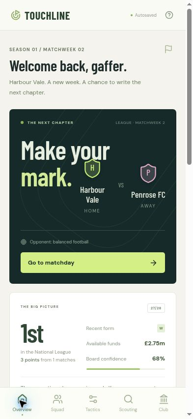

# Touchline — Club Architect

[Play Touchline on Cloudflare](https://touchline-93s.pages.dev/) · [Private ChatGPT Site](https://touchline-club-architect.anassadaacca.chatgpt.site)



An original football management game built for phones and desktop browsers. Choose Harbour Vale, Marlowe Town or Bracken Athletic and build a long-running career in a fictional two-division world. This game is independent of Everstead, which lives in the sibling `everstead/` directory.

## Play

1. Choose a club and take the manager’s seat.
2. Read the story **On your desk**. Decisions affect morale, fitness, finances, supporters, facilities or board confidence.
3. Select your starting eleven in **Squad**. Starting a reserve replaces an injured starter first, then the lowest-rated starter in that natural position, or a non-goalkeeper if no position matches. Injured reserves cannot start.
4. Choose formation, mentality, pressing, tempo and weekly training in **Tactics**.
5. Use **Scouting** to sign players or sell reserves. The market refreshes every three matchweeks. Fees and weekly wages matter; the squad limit is 25 and sales cannot reduce it below 14.
6. Go to matchday. Play six 15-minute passages, adjusting tactics between them. The score, expected goals and commentary update as play advances. Continue after full-time to settle league results, wages, income, training and recovery.
7. Repeat across 18-match seasons. The top two National League teams are promoted; the bottom two Premier League teams are relegated. Prize funding, aging, retirements, at least three academy recruits and changing rival strengths carry the story into the next season. Additional youth players keep retirement-heavy squads above the 14-player minimum, and the starting eleven retains exactly one goalkeeper.

## What changes the game

- 20 fictional clubs, two divisions, home-and-away schedules and league standings.
- Seeded match outcomes influenced by squad quality, fitness, morale, home advantage, opponent strength and tactical choices.
- Attacking football creates more openings and exposes the defence. Cautious play reduces chances at both ends. Pressing and quick tempo cost fitness during the match.
- Formation provides a small matchup bonus: 4-3-3 against cautious teams, 3-5-2 against attacking teams, 4-4-2 against balanced teams.
- Weekly recovery, technical training, youth development, injuries and squad rotation.
- A transfer shortlist, affordability guards, reserve sales, wages, matchday income, academy and scouting investment.
- Ten authored off-pitch story types, with two choices each, varied in order without an immediate repeat.
- Season archive, career win record, promotion, relegation and youth renewal. Squads are capped at 25 at rollover by releasing the weakest reserves.
- Autosave, JSON export/import, corruption validation and an autosave failure warning.

This is a complete small browser management game, not a Football Manager replacement. Rival clubs are represented by persistent league statistics, strength and style rather than full independently simulated rosters. Matches are probabilistic passages with commentary, not 3D football or a ball-physics engine. There are no cup competitions, negotiations, multiplayer, real clubs or licensed players. Board confidence and fan sentiment are feedback systems; there is no dismissal system. Authored story types are finite and repeat. Long careers are supported, but no game can guarantee that every person will remain engaged indefinitely.

## Saves and privacy

No account, purchases, ads, analytics or gameplay API keys. Fonts and icons are bundled locally. Progress lives in this browser’s local storage; no time passes while closed. Use **Club → Export save** before changing phones, clearing browser data, or changing URLs. Import restores the career, including a match in progress. Keep backups: local storage can be cleared by your browser or device.

## Development

Requires Node.js 24.

```sh
cd football-manager
npm ci
npm test
npm run dev
```

```sh
npm run build
```

Vite emits a standalone site in `dist/`. It can be hosted on any static host; no server or secrets are required. The development port is 4174; the managed ChatGPT preview supervisor uses 4173.

- `src/game.ts`: pure simulation and state transitions.
- `src/save.ts`: versioned save encoding, validation and browser storage.
- `src/App.tsx`: onboarding, management views and matchday interface.
- `src/style.css`: responsive visual design.
- `tests/`: deterministic campaigns, legal actions, progression and save tests.
- `docs/superpowers/`: design and implementation plan.

## Research and original design

Research checked 23 October 2026. These official sources informed general mechanics; no franchise assets, databases, wording or code are copied.

- [Football Manager: youth intake and development](https://www.footballmanager.com/the-dugout/developing-and-maximising-your-youth-intakes-fm26) — facilities, coaching and uncertainty support long-term recruitment.
- [Football Manager: end-of-season run-in](https://www.footballmanager.com/the-dugout/mastering-end-season-run-fm26) — morale, fatigue and tactical adaptation connect decisions across a season.
- [Football Manager Mobile feature overview](https://www.footballmanager.com/fm26/features/football-manager-26-mobile-new-features-showcase) — accessible mobile management and persistent career progression.
- [EA SPORTS FC career features](https://www.ea.com/games/ea-sports-fc/fc-26/features/fc-26-career-mode) — changing situations and unexpected events renew the manager’s priorities.

The original visual direction uses warm paper, dark ink, lime highlights, custom club shields and a CSS tactical pitch. Fonts: Barlow Condensed and DM Sans via Fontsource. Icons: Lucide. Built with React, TypeScript and Vite.
